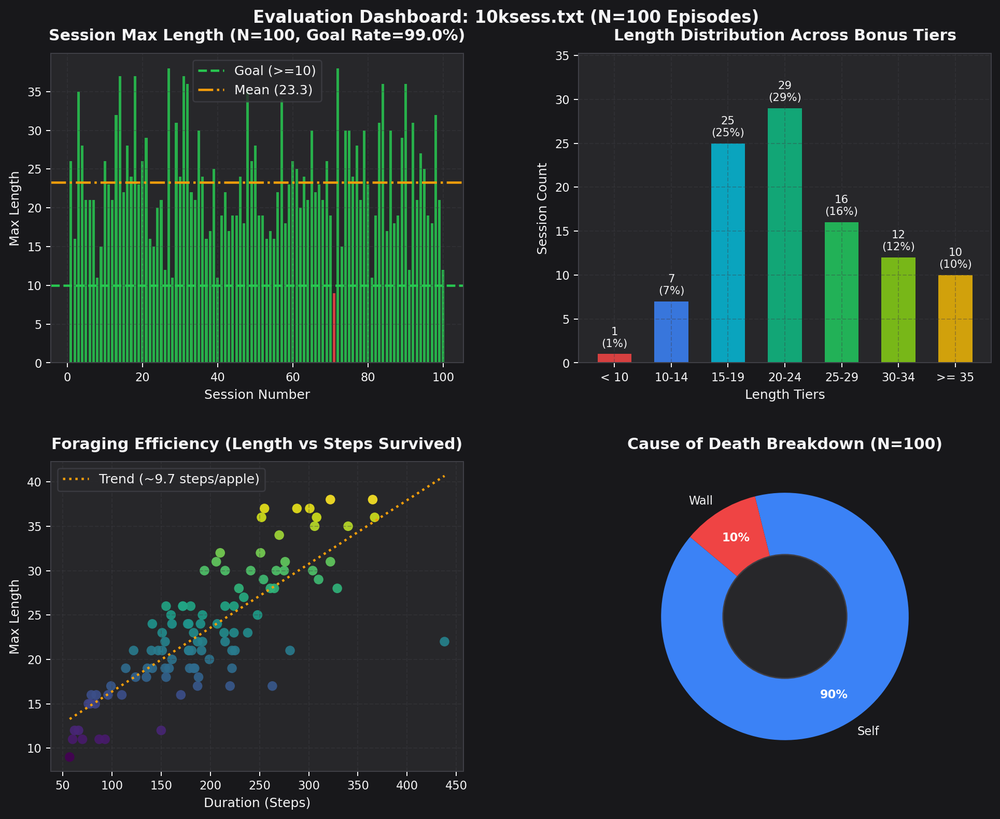

<p align="right">
  <a href="#learn2slither-貪食蛇強化學習">
    
  </a>
</p>

# Learn2Slither

An AI-driven Reinforcement Learning Snake game built with **Python** and **Pygame**, following the subject restrictions. The snake agent learns to navigate a 10×10 grid, consume green apples to grow, avoid red apples, and survive solely through tabular **Q-learning** based on a restricted 4-direction ray-cast vision.

<p align="center">
  
  
  
  
</p>

---

## ✨ Features

- **10×10 Board Environment**:
  - Dynamically maintains **2 Green Apples** (+1 length) and **1 Red Apple** (-1 length) placed randomly on empty cells.
  - Starts with an initial snake of **3 contiguous cells** placed randomly.
  - Game terminates when hitting a wall, colliding with itself, or when length drops to 0.
- **Strict 4-Direction Ray-cast Vision**:
  - The snake only sees along 4 orthogonal ray casts (`UP`, `LEFT`, `DOWN`, `RIGHT`) from its head.
  - Vision characters: `W` (Wall), `H` (Head), `S` (Body segment), `G` (Green apple), `R` (Red apple), `0` (Empty).
  - **No board-level coordinate leakage**.
  - Displays the cross-shaped vision in the terminal before every decision.
- **Pure Q-Learning Architecture (Subject IV.5)**:
  - Tabular Q-learning driven by the Bellman optimality equation:
    $$Q(s, a) \leftarrow Q(s, a) + \alpha [r + \gamma \max_{a'} Q(s', a') - Q(s, a)]$$
  - $\epsilon$-greedy exploration-exploitation schedule with decay.
  - Fully supports `-x, --dontlearn` mode (pure exploitation without updating Q-values) for evaluation.
- **Decoupled Engine for Blazing-Fast Training**:
  - Headless mode (default when `-v, --visual` is omitted) completely decouples Pygame rendering and terminal printing, simulating tens of thousands of steps per second.
- **Model Persistence**:
  - Full model export and restore (`-s, --save <path>` and `-l, --load <path>`).
  - Pre-trained models included for peer evaluation: `1sess.txt`, `10sess.txt`, `100sess.txt`, `1000sess.txt`, and `10ksess.txt`.
- **Interactive Pygame UI**:
  - Step-by-step stepping mode (`-step, --step-by-step`) using the spacebar, step-back/undo via `R`, or manual keyboard steering, with gray 4-direction vision ray highlighting and dynamic window resizing.
  - Real-time score, session counter, duration, and speed controls (`+` / `-`).

---

## 🏗️ Technical Architecture (Subject Part 6)

The project strictly follows the modular architecture defined in the subject:

```
       ┌───────────────────────────┐
       │        ENVIRONMENT        │
       │  (Board, Snake, Rules)    │
       └─────┬───────────────▲─────┘
             │               │
      (Observation)       (Action)
             │               │
             ▼               │
       ┌───────────┐         │
       │INTERPRETER│         │
       └─────┬─────┘         │
             │               │
     (State, Reward)         │
             │               │
             ▼               │
       ┌───────────┐         │
       │   AGENT   ├─────────┘
       │ (Q-table) │
       └───────────┘
```

- **`src/core/`**:
  - `snake.py`: Snake body mechanics, contiguous spawn, growth/shrink, and self-collision detection.
  - `environment.py`: Grid state management, apple spawning, 4-direction ray vision extraction, terminal cross rendering, and step execution.
- **`src/ai/`**:
  - `q_table.py`: Tabular Q-learning agent, Bellman updates, $\epsilon$-greedy decision logic, and plain-text model serialization (`save` / `load`).
- **`src/ui/`**:
  - `gui.py`: Pygame graphical interface (`UI` class), grid rendering, HUD status overlay, step-by-step loop, and dynamic FPS regulation.
- **`src/config/`**:
  - `game.py`: Board constants, object tokens, and canonical action directions (`DIRECTIONS`).
  - `ai.py`: Hyperparameters ($\alpha, \gamma, \epsilon$) and reward weights.
  - `ui.py`: Window dimensions, color palette, and keyboard mappings (`KEY_TO_DIR`).

---

## 🚀 Installation & Compilation

```bash
# Clone the repository
git clone <repo-url> Learn2Slither
cd Learn2Slither

# Install dependencies and build ./snake executable
make
```

### Makefile Rules

- `make all`: Verifies dependencies (`pygame`, `flake8`) and generates the `./snake` executable launcher.
- `make clean`: Removes Python bytecode cache (`__pycache__`, `*.pyc`).
- `make fclean`: Cleans cache and deletes the `./snake` binary.
- `make re`: Full clean and rebuild.
- `make norm`: Validates PEP 8 compliance using `flake8` (`--max-line-length=100`).
- `make test`: Runs automated unit test suites.
- `make help`: Displays available targets and usage guide.

---

## 🛠️ Usage & Evaluation Commands

### 1. Fast Headless Training (e.g. 10 sessions)
```bash
./snake --sessions 10 --save models/10sess.txt
# Short flags equivalent:
./snake -n 10 -s models/10sess.txt
```
*Outputs standard completion statistics:*
```
Game over, max length = 4, max duration = 17.
Save learning state in models/10sess.txt.
```

### 2. Peer-Evaluation Verification (Step-by-Step Mode)
```bash
./snake --visual --load models/100sess.txt --sessions 10 --dontlearn --step-by-step
# Short flags equivalent:
./snake -vxl models/100sess.txt -n 10 -step
```
*Loads pre-trained weights without altering the Q-table, stepping through each move with visual UI (`SPACE` to step, `R` to undo) and terminal feedback.*

### 3. Batch Evaluation & Automated Dashboard Plotting
```bash
./snake --load models/10ksess.txt --sessions 100 --dontlearn
# Short flags equivalent:
./snake -xl models/10ksess.txt -n 100
```
*Outputs standard per-session metrics, followed by an aggregated benchmark report (Average/Median length, Goal rate $\ge 10$, Bonus tiers, Foraging efficiency, and Death causes), and automatically exports a non-overwriting 2x2 dashboard plot to `assets/img/eval_M?S?.png`:*
```
==========================================================
            Batch Evaluation Summary (N=100)
Model               : models/10ksess.txt
==========================================================
Average Length      : 23.29
Median Length       : 22.0
Min / Max Length    : 9 / 38
Std Deviation       : 7.02
Goal Rate (>= 10)   : 99.0% (99/100)
Bonus Tiers:
  >=15: 92.0% | >=20: 67.0% | >=25: 38.0% | >=30: 22.0% | >=35: 10.0%
Avg Foraging Rate   : 9.67 steps / green apple
Death Reasons       : Self: 90.0% | Wall: 10.0% | Zero Length: 0.0%
----------------------------------------------------------
Saved evaluation chart to: assets/img/eval_M10kS100_3.png
==========================================================
```



---

## 📋 Command-Line Arguments Reference

| Option | Default | Description |
| :--- | :---: | :--- |
| `-n, --sessions <N>` | `1` | Number of training/evaluation games to execute. |
| `-s, --save <path>` | × | Export learned Q-values to target file upon completion. |
| `-l, --load <path>` | × | Import pre-trained model weights before starting. |
| `-v, --visual` | `off` | Enable Pygame graphical interface and terminal vision. |
| `-x, --dontlearn` | `off` | Disable learning (pure exploitation, Q-table remains frozen). |
| `-step, --step-by-step` | `off` | Advance simulation one step at a time via keyboard trigger. |
| `-b, --board-size <N>` | `10` | Optional dimension for an $N \times N$ grid. |

---

## 📚 Project Documentation
- [Comprehensive Walkthrough & Defense Prep](docs/walkthrough.md): Technical deep-dive, ray vision encoding, Q-learning mechanics, and peer evaluation Q&A.
- [Implementation Checklist & Roadmap](docs/TODO.md): Full breakdown of subject rules, banned practices, refactoring steps, and bonus features.
- [Development Patch Notes & Changelog](docs/PATCH_NOTES.md): Milestone history and release notes.
- [Official Subject](docs/en.subject.pdf): The original project specification.

<br/>

---

<br/>

<p align="right">
  <a href="#learn2slither">
    
  </a>
</p>

# Learn2Slither (貪食蛇強化學習)

基於 **Python** 與 **Pygame** 開發之貪食蛇強化學習專案，嚴格遵循 **官方規範手冊 (Subject)**。智能體（Agent）在 $10 \times 10$ 的網格棋盤中，僅依賴蛇頭四向射線視野，透過純粹的表格型 **Q-learning** 演算法學會自主尋找綠蘋果增長、避開紅蘋果與牆壁，並達成持久存活。

<p align="center">
  
  
  
  
</p>

---

## ✨ 核心特點

- **$10 \times 10$ 棋盤環境**：
  - 盤面常駐 **2 顆綠蘋果**（長度 $+1$）與 **1 顆紅蘋果**（長度 $-1$），隨機刷新於空格。
  - 起始蛇長度為 **3 格**，隨機且**連續**（contiguously）放置於棋盤空格。
  - 碰撞牆壁（Wall）、碰撞自身軀幹（Tail）、或長度萎縮至 0 時判定遊戲結束（Game Over）。
- **嚴格四向射線視野 (Ray-cast Vision)**：
  - 蛇只能看到從蛇頭朝向四個方向（`UP`, `LEFT`, `DOWN`, `RIGHT`）直線射線上的物體。
  - 視野字元：`W` (牆)、`H` (蛇頭)、`S` (身體節點)、`G` (綠蘋果)、`R` (紅蘋果)、`0` (空格)。
  - **嚴禁洩漏棋盤全域座標**。
  - 每次做決策前，於終端機精確輸出十字型視野與採取之動作。
- **純粹的 Q-learning 演算法架構 (Subject IV.5)**：
  - 基於 Bellman 最優方程式更新 Q-table：
    $$Q(s, a) \leftarrow Q(s, a) + \alpha [r + \gamma \max_{a'} Q(s', a') - Q(s, a)]$$
  - 具備 $\epsilon$-greedy 探索與利用（Exploration vs Exploitation）動態調度。
  - 完整支援 `-x, --dontlearn` 模式（純利用不更新權重，供評審客觀檢視各階段學習成效）。
- **環境與渲染解耦的極速訓練引擎**：
  - 預設為無介面模式（未加 `-v, --visual` 時），徹底關閉 UI 渲染與終端刷新，每秒可運算數萬步，幾秒鐘即可完成數百至數千回合訓練。
- **模型持久化保存與還原**：
  - 完整模型儲存與載入機制（`-s, --save <path>` 與 `-l, --load <path>`）。
  - 內建繳交必備之預訓練模型檔案：`1sess.txt`、`10sess.txt`、`100sess.txt`、`1000sess.txt`、以及完全收斂的 `10ksess.txt`。
- **Pygame 互動圖形介面**：
  - 支援單步步進模式 (`-step, --step-by-step`)，可按空白鍵逐步前進、按 `R` 鍵回退上一步（Undo）、顯示灰色十字射線視野、動態縮放視窗，或以方向鍵/WASD 介入控制。
  - 即時顯示目前長度、存活時間、回合數與動態速度調節（`+` / `-` 鍵變更 FPS）。

---

## 🏗️ 模組化架構藍圖 (Subject Part 6 Technical Structure)

本專案遵循專案規範定義的三大模組分層架構：

```
       ┌───────────────────────────┐
       │        ENVIRONMENT        │
       │  (棋盤、蛇本體、碰撞規則)  │
       └─────┬───────────────▲─────┘
             │               │
       (環境觀察事件)       (動作 Action)
             │               │
             ▼               │
       ┌───────────┐         │
       │INTERPRETER│         │
       └─────┬─────┘         │
             │               │
     (狀態 State, 獎勵 Reward)│
             │               │
             ▼               │
       ┌───────────┐         │
       │   AGENT   ├─────────┘
       │ (Q-table) │
       └───────────┘
```

- **`src/core/`**：
  - `snake.py`：蛇身體隊列操作、隨機連續 3 格生成、移動增減、以及自身碰撞檢測。
  - `environment.py`：棋盤狀態管理、蘋果隨機刷新、四向射線特徵提取、十字型視野渲染與環境 `step(action)` 執行引擎。
- **`src/ai/`**：
  - `q_table.py`：Q-table 狀態映射、Bellman 方程式更新、$\epsilon$-greedy 決策邏輯、以及純文字模型存取。
- **`src/ui/`**：
  - `gui.py`：Pygame 視覺化介面（`UI` 類別）、網格繪圖、抬頭 HUD 資訊、單步步進事件循環與流暢速度調節。
- **`src/config/`**：
  - `game.py`：棋盤常數、物件標記符號與標準方向定義（`DIRECTIONS`）。
  - `ai.py`：Q-learning 超參數（$\alpha, \gamma, \epsilon$）與各項獎勵數值配置。
  - `ui.py`：視窗尺寸、配色方案與按鍵映射（`KEY_TO_DIR`）。

---

## 🚀 安裝與編譯構建

```bash
# 取得專案原始碼
git clone <repo-url> Learn2Slither
cd Learn2Slither

# 安裝相依套件並編譯生成可執行檔 ./snake
make
```

### Makefile 核心目標說明

- `make` / `make all`：驗證相依套件（`pygame`, `flake8`）並生成 `./snake` 執行包裝腳本。
- `make clean`：清理 Python 快取目錄（`__pycache__`, `*.pyc`），具備平滑進度條反饋。
- `make fclean`：完整清除快取並移除可執行檔 `./snake`。
- `make re`：一鍵深度清理並重新構建。
- `make norm`：使用 `flake8` 檢驗程式碼是否符合代碼規範（`--max-line-length=100`）。
- `make test`：執行單元測試套件（驗證蛇行為與視野產生）。
- `make help`：顯示所有目標與題目規格指令範例。

---

## 🛠️ 評分與測試常用指令範例

### 1. 高速無介面訓練（訓練 10 回合並儲存模型）
```bash
./snake --sessions 10 --save models/10sess.txt
# 縮寫等價寫法：
./snake -n 10 -s models/10sess.txt
```
*終端輸出標準結尾統計格式（符合 Subject Page 13 規範）：*
```
Game over, max length = 4, max duration = 17.
Save learning state in models/10sess.txt.
```

### 2. 檢驗模式（載入 100 回合模型、單步推進、凍結權重）
```bash
./snake --visual --load models/100sess.txt --sessions 10 --dontlearn --step-by-step
# 縮寫等價寫法：
./snake -vxl models/100sess.txt -n 10 -step
```
*載入已訓練權重且不更新 Q 表，在圖形視窗中按空白鍵單步前進（按 `R` 鍵可回退上一步），終端同步輸出十字視野與決策動作。*

### 3. 批次評估驗收與自動圖表生成 (Batch Benchmark)
```bash
./snake --load models/10ksess.txt --sessions 100 --dontlearn
# 縮寫等價寫法：
./snake -xl models/10ksess.txt -n 100
```
*除依規範逐局輸出標準結尾統計外，結尾自動彙整評估摘要（平均/中位數長度、42 及格率 $\ge 10$、Bonus 階層佔比、綠蘋果覓食效率與死因剖析），並自動生成 2x2 綜合評估儀表板圖表儲存至 `assets/img/eval_M?S?.png`：*
```
==========================================================
            Batch Evaluation Summary (N=100)
Model               : models/10ksess.txt
==========================================================
Average Length      : 23.29
Median Length       : 22.0
Min / Max Length    : 9 / 38
Std Deviation       : 7.02
Goal Rate (>= 10)   : 99.0% (99/100)
Bonus Tiers:
  >=15: 92.0% | >=20: 67.0% | >=25: 38.0% | >=30: 22.0% | >=35: 10.0%
Avg Foraging Rate   : 9.67 steps / green apple
Death Reasons       : Self: 90.0% | Wall: 10.0% | Zero Length: 0.0%
----------------------------------------------------------
Saved evaluation chart to: assets/img/eval_M10kS100_3.png
==========================================================
```


---

## 📋 參數手冊 (CLI Reference)

| 參數選項 | 預設值 | 說明 |
| :--- | :---: | :--- |
| `-n, --sessions <N>` | `1` | 指定要執行的訓練或評估回合數（Session 數量）。 |
| `-s, --save <path>` | × | 訓練結束後，將當前學習到的 Q-values 匯出至指定文字檔。 |
| `-l, --load <path>` | × | 啟動時先載入預訓練模型檔案，接續學習或進行純利用展示。 |
| `-v, --visual` | `off` | 開啟 Pygame 圖形視覺化介面與終端十字視野輸出。 |
| `-x, --dontlearn` | `off` | 停用學習更新（純利用 Exploitation，不更新 Q-table 權重）。 |
| `-step, --step-by-step` | `off` | 啟用單步步進模式，按鍵推進一步，方便逐手檢驗視野與決策。 |
| `-b, --board-size <N>` | `10` | 自訂棋盤尺寸 $N \times N$。 |

---

## 📚 專案文檔索引
- [深度導讀與答辯指南 (walkthrough.md)](docs/walkthrough.md)：架構技術細節、射線視野特徵編碼、Q-learning 數學原理與口試 Q&A。
- [實作任務清單與規範對照 (TODO.md)](docs/TODO.md)：Subject 規範剖析、三大禁區警示、重構步驟與驗收清單。
- [版本演進與補丁歷程 (PATCH_NOTES.md)](docs/PATCH_NOTES.md)：從 v0.1.0 起的里程碑紀錄與詳細變更。
- [規範手冊 (en.subject.pdf)](docs/en.subject.pdf)：官方專案要求與評分標準原件。